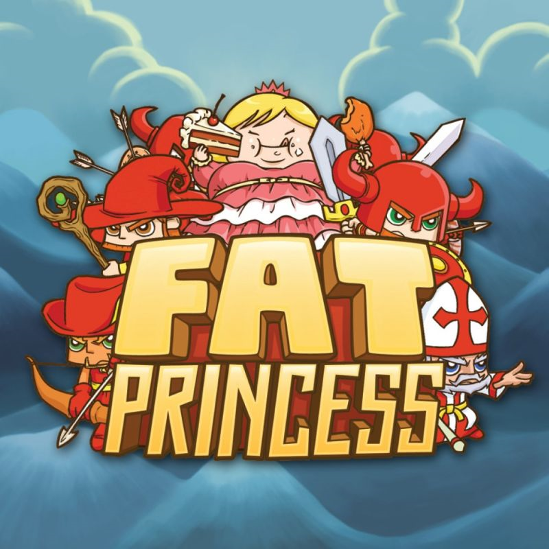

<p align="center">
  
</p>

<h1 align="center">Fat Princess Recomp</h1>

<p align="center">
  A native Windows and Linux recompilation of <b>Fat Princess</b> (PS3, NPUA80139 v2.00) with the <b>Fat Roles</b> expansion.<br>
  No emulator: the game's own PowerPC and SPU code, translated to C++ and running on a reimplemented PS3 runtime.
</p>

<p align="center">
  
  
  
  
  
  
  <br>
  
  
  
  
  
</p>

---

## Contents

- [Status](#status)
- [Features](#features)
- [Requirements](#requirements)
- [Setting up from a fresh clone](#setting-up-from-a-fresh-clone)
- [Building](#building)
- [Playing](#playing)
- [Linux and Steam Deck](#linux-and-steam-deck)
- [Settings](#settings)
- [Repository layout](#repository-layout)
- [Regenerating the translated code](#regenerating-the-translated-code)
- [Credits](#credits)

## Status

| Area | State |
|---|---|
| Game code (24,882 PPU functions, 26 SPU programs) translated to native code | :white_check_mark: Done |
| Boot, menus, story mode, every multiplayer mode and map | :white_check_mark: Playable |
| Fat Roles classes and upgrades | :white_check_mark: Working |
| Saves (story progress, options) | :white_check_mark: Working |
| Performance: steady 30 FPS, the PS3's own frame rate and game speed | :white_check_mark: Done |
| Stability: multi-hour sessions without a crash | :white_check_mark: Done |
| Launcher, key remapping, PC button icons, menu hints | :white_check_mark: Done |
| Native Linux and Steam Deck build | :test_tube: Being tested on a Steam Deck |
| Smarter bots (opt-in "Improved" mode) | :construction: In progress |
| 60 FPS mode | :pause_button: Shelved (the game's logic steps a fixed 1/30 s per frame) |
| Graphics options, mod support, online play | :spiral_calendar: Planned |

## Features

- **Native code.** Every PPU function of the game is translated to C++, and the SPU programs (physics, audio DSP, jobs) to C. Behaviour stays 1:1 with the PS3, including physics and AI.
- **Vulkan renderer.** The game's RSX command stream runs on Vulkan. Shaders are translated to SPIR-V and cached on disk, so each one compiles only once.
- **Original pacing.** The game paces itself to 30 FPS off a 59.94 Hz refresh, as on the console, with a matching cap.
- **Launcher.** `FatPrincessLauncher.exe` has tabs for Graphics, Controls, Bots, Performance, Online and Game files. Settings save as they change.
- **Keyboard and mouse.** Every PS3 button can be remapped, with up to four keys or mouse buttons each. The Controls tab explains what each button does in the game and offers two recommended layouts, one of them keyboard-only for 60% boards. An Xbox-style controller works automatically.
- **PC button icons.** Every prompt in the game shows your bound keys, Xbox buttons, or the original PlayStation icons. Auto picks keys or Xbox depending on whether a controller is plugged in.
- **Quality of life.** All of these are switchable:
  - Move / Select / Back hints at the bottom of the menus;
  - an option to skip the "Noob Assistance Program" question;
  - hidden split-screen START signs.
- **Data patches.** Changes to the game's scripts and textures are applied to a patched copy of `siege.qrk` at start-up. The original is never touched, and when only the set of patches changes the copy is updated in place, not copied again.
- **Diagnostics.**
  - F8 writes a 30-second performance report (`perf_report.txt`).
  - An optional CPU profiler is available.
  - F10 writes a freeze report.

## Requirements

- **Windows 10 or 11, x64**, and a GPU with Vulkan 1.2.
- **Visual Studio 2022** (Community or Build Tools) with:
  - the workload *Desktop development with C++*;
  - the individual components *C++ Clang Compiler for Windows* and *C++ CMake tools for Windows*.
- **Your own copy of Fat Princess** (NPUA80139, updated to v2.00). The decrypted `GAME.elf` and `siege.qrk` are needed; RPCS3 can provide both.
- **A PS3 firmware `dev_flash` folder.** RPCS3 has one; the game loads its audio codecs from it.
- **Optional:** your Fat Roles licence (`.rap`), for the expansion.
- **Optional:** Python 3.10+, only for the tools and for regenerating the translated code.

## Setting up from a fresh clone

The repository holds the port, not the game. On a new PC:

1. **Game files.** Put the game folder at `vfs\dev_hdd0\game\NPUA80139\`, so that `USRDIR\GAME.elf` and `USRDIR\siege.qrk` exist. The launcher's *Game files* tab can copy `siege.qrk` over from RPCS3.
2. **Translated code.** Restore `recompiled\` and `spu\` from your own backup, or regenerate them from `GAME.elf` (see [Regenerating the translated code](#regenerating-the-translated-code)).
3. **Artwork (optional).** Put `fp.ico` and `logo.bmp` in `assets\` for the window icon and the launcher logo. The build works without them.
4. **Build** with `build.bat` (next section).
5. **First start.** In the launcher's *Game files* tab:
   - set the `dev_flash` folder (left empty, it is looked for automatically);
   - for Fat Roles, enter the 32-digit licence key. `python tools\rap_to_key.py <file>.rap` prints it.

## Building

Double-click **`build.bat`**. It finds Visual Studio, configures with CMake and Ninja using `clang-cl`, and builds:

- `build\FatPrincessRecomp.exe`, the game;
- `FatPrincessLauncher.exe`, the launcher, copied next to `build.bat`.

The first build compiles about 3 million lines of translated code and can take an hour or more. Later builds only recompile what changed. Everything is logged to `build.log`.

> [!TIP]
> If the build runs out of memory, run `set JOBS=2` in a Command Prompt here, then `build.bat`. Each translated file can take 2-4 GB of RAM to compile.

For an unattended build, `tools\auto_build.bat` answers the final prompt and writes `ok` or `failed` to `auto_build.done`.

## Playing

Start **`FatPrincessLauncher.exe`**, pick your settings and press **Play**. `run.bat` starts the game without the launcher. The game log goes to `run.log`.

| Key | Action |
|---|---|
| <kbd>Alt</kbd> + <kbd>Enter</kbd> | Toggle borderless full screen |
| <kbd>F8</kbd> | Record 30 s and write `perf_report.txt` |
| <kbd>F9</kbd> | Record a 10 s timeline (with the profiler on) |
| <kbd>F10</kbd> | Write a freeze report to `run.log` |

## Linux and Steam Deck

The game also builds natively for Linux, with the same code, an SDL2 window and the Vulkan renderer. No Wine or Proton is involved. The full guide, including the Steam Deck setup, is in [`docs/LINUX.md`](docs/LINUX.md). In short:

```sh
./build.sh                 # needs clang, cmake, ninja and the SDL2 dev files
./tools/package_linux.sh   # dist/FatPrincess-Linux.tar.gz, ready for a Steam Deck
```

On the Deck, add `fatprincess.sh` to Steam as a non-Steam game, with no Proton. The Deck's controls act as an Xbox controller, and the prompts show A, B, X and Y. `fatprincess.ini` is shared with Windows, but there is no launcher on Linux yet.

## Settings

Everything lives in **`fatprincess.ini`** next to the launcher. The launcher edits it; deleting it restores the defaults.

| Section | What it holds |
|---|---|
| `[Graphics]` | `Renderer`, `Fullscreen`, `VSync`, `ShowFPS`, `GPU`, and `FrameLimit`: `30` (original), `60fps` or `unlocked` (both experimental) |
| `[Controls]` | Key bindings for all 24 PS3 inputs; `ButtonIcons` (`auto`, `keyboard`, `xbox`, `ps`); `MenuHints`; `SkipHowToPlayPrompt`; `HideCoopStart` |
| `[Bots]` | `Mode` (`classic`, exactly as on the PS3, or `improved`); `Siege` |
| `[Online]` | `Enabled`, `Server`, `Username` (online play is not finished yet) |
| `[Performance]` | `Priority`, `FreeCores`, `Profile`, `WaitMode`, `SpuThreadReuse` |
| `[Paths]` | `DevFlash`, `DlcKey` |

## Repository layout

| Path | What |
|---|---|
| `main.cpp` | Program entry: window, frame clock and vblank pacing, boot, hotkeys |
| `fp_config.cpp`, `fp_ini_defaults.h` | Reads `fatprincess.ini` and applies it; the default settings |
| `fp_data_patches.cpp` | Builds and serves the patched copy of `siege.qrk` (scripts, bots, menu hints) |
| `fp_button_icons.cpp` | Repaints the button glyphs in the game's fonts as keys, mouse buttons or Xbox buttons |
| `perf_report.cpp`, `fp_profile.cpp` | Performance report (F8) and CPU profiler |
| `stubs.cpp` | Game-specific hooks and overrides |
| `launcher/` | `FatPrincessLauncher.exe` (Win32, one file) |
| `ps3recomp/` | The recompilation toolkit and PS3 runtime ([ps3recomp](https://github.com/sp00nznet/ps3recomp), MIT), with this project's changes |
| `ext/` | Vulkan headers and glslang (shader compiler), built with the game |
| `assets/` | Windows resource template; the icon and logo files stay local |
| `analysis/` | Function list, imports and segment map used for the translation |
| `tools/` | `qrk.py` (archive list, extract, pack), `pkg_extract.py`, `ps3elf.py`, `rap_to_key.py`, and the developer scripts `bench.bat`, `bench_prof.bat`, `capture.bat`, `auto_build.bat` |
| `config.toml` | Toolkit configuration (reference) |
| `CMakeLists.txt`, `build.bat`, `run.bat` | Build and run (Windows) |
| `build.sh`, `fatprincess.sh`, `tools/package_linux.sh` | Build, run and package (Linux, Steam Deck) |
| `fonts/` | DejaVu Sans Bold (free licence): letters for the button icons on Linux |
| `docs/` | `LINUX.md`, the Linux and Steam Deck guide |

## Regenerating the translated code

Only needed on a fresh clone without a backup, or after changing the function list or updating the toolkit. Needs Python 3.10+.

**PPU code** (`recompiled\`):

```bat
python ps3recomp\tools\ppu_lifter.py vfs\dev_hdd0\game\NPUA80139\USRDIR\GAME.elf ^
  --functions analysis\functions.json --hle-stubs analysis\GAME.imports.json ^
  --code-end 0xa83f4c --chunks 48 --output recompiled\
python ps3recomp\tools\gen_hle_nids.py --out recompiled\ppu_hle_nids.cpp --all
```

**SPU programs** (`spu\`): `ps3recomp\tools\extract_spu_images.py` finds the SPU programs inside `GAME.elf`, and `ps3recomp\tools\build_spu_workloads.py` lifts them and writes `spu\spu_workloads.c`. The steps are in [`ps3recomp/docs/GETTING_STARTED.md`](ps3recomp/docs/GETTING_STARTED.md) (*Lift SPU programs*). The MultiStream audio overlays (`spu\ovl_ms_a`, `spu\ovl_ms_b`) were lifted separately from the audio library's overlay images, so keep them with your backup.

## Credits

- **Fat Princess** by Titan Studios, published by Sony Computer Entertainment (2009). Fat Roles expansion (2010).
- **[ps3recomp](https://github.com/sp00nznet/ps3recomp)** (MIT): the static recompiler and PS3 runtime this port is built on.
- **[Vulkan-Headers](https://github.com/KhronosGroup/Vulkan-Headers)** and **[glslang](https://github.com/KhronosGroup/glslang)** by the Khronos Group.

<p align="center"><sub>A private, personal project, made out of love for the original game.</sub></p>
